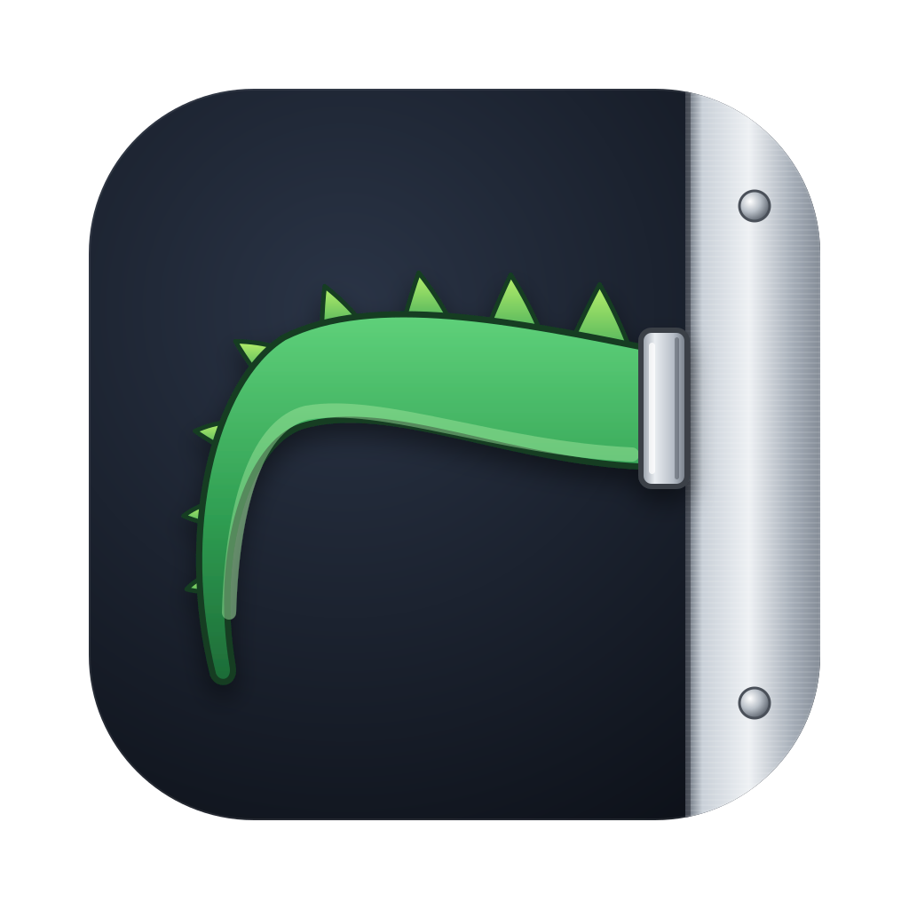

<p align="center"></p>

# Rex's Tail

A widget panel that docks to the right side of the Rex terminal window on macOS.

Rex's Tail is a separate app. It doesn't modify, patch or inject anything into Rex. It follows Rex's window using the macOS Accessibility API and gets its data from Rex's public `rex` command-line tool.

## Widgets

- **Weather.** Current conditions for your Mac's location from [Open-Meteo](https://open-meteo.com), which is free and needs no API key.
- **Agents.** Every Claude Code and Codex session running in a Rex pane, on this Mac and on any Rex host you're connected to. Each card shows:
  - status: working, needs you, or idle
  - how long it has been running
  - the number of turns
  - context size and output tokens; hover for the full token breakdown

  Click a card to jump to that pane.

## How it works

- **Docking.** The panel is a borderless window placed beside Rex's main window. When it appears, it narrows Rex just enough to fit and gives the width back when hidden. It follows Rex across moves, resizes, Spaces and full screen. When Rex isn't the app in front (another app is active, or Rex is hidden, minimized, quit or on another Space), the panel becomes a drawer: a slim handle on the right edge of the screen. Point at the handle and the panel slides out over other apps; move away and it slides back. It re-docks when Rex comes back.
- **Local agents.** Rex reports each pane's foreground program and status. Token usage comes from the agents' own logs: `~/.claude/projects/…/<session>.jsonl` for Claude Code and `~/.codex/sessions/…/rollout-*.jsonl` for Codex.
- **Remote agents.** Status comes from `rex -S <host>`. For token usage, Rex's Tail keeps one SSH connection per host and runs `Resources/agent_reader.py` there. The script only reads the agent logs and returns summary numbers. It's sent over the connection each time, so nothing is installed on the remote machine. The SSH alias must be the Rex host label in lowercase, and key-based login must work without a prompt (`BatchMode=yes`).

## Build

You need macOS 15 or later, Xcode or the Swift 6 toolchain, and Rex.

```sh
scripts/build.sh --run
```

The script builds `build/Rex's Tail.app` and signs it with your `Apple Development` certificate. Override the certificate with `SIGN_IDENTITY`. Signing with the same certificate every time keeps the Accessibility permission across rebuilds.

On first launch, allow **Rex's Tail** in System Settings → Privacy & Security → Accessibility.

## Use

- **⌃⌥⌘W** shows or hides the panel.
- The menu bar icon has the same toggle, plus Quit.

## License

MIT. See [LICENSE](LICENSE).
